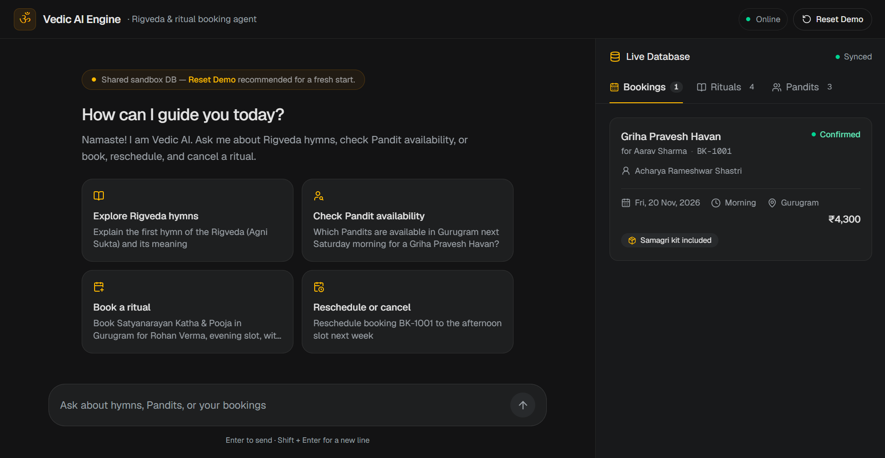

# 🕉️ Vedic AI Engine — Frontend

An AI agent chat interface for exploring **Rigveda hymns** and managing **Vedic ritual bookings**: checking Pandit availability, and booking, rescheduling or cancelling a pooja or havan in plain language. Next to the chat, a **Live Database** panel shows bookings, rituals and Pandits, and it updates after every agent action.



---

## ✨ Features

- **Conversational AI agent.** Ask about Rigveda hymns (for example, the Agni Sukta), check Pandit availability, or manage bookings in natural language.
- **Agent tool trace.** Each assistant reply can show how many reasoning steps and tool calls the agent made, with the input of each tool call.
- **Live Database sidebar.** Tabs for **Bookings**, **Rituals** and **Pandits**. The panel refreshes automatically after each agent response.
- **Quick prompts.** One-click starter cards that match the seeded demo data. Dates are generated when you click, so they are always in the future.
- **Markdown replies.** Assistant messages render GitHub-flavoured Markdown (tables, lists, code) through `react-markdown` and `remark-gfm`.
- **Persistent chat history.** The conversation is saved to `localStorage` and restored when you reload the page.
- **Reset Demo.** Resets the shared sandbox database to its seed state and clears the local chat history.
- **Backend health status.** The header shows *Waking up*, *Online* or *Error*. Input is disabled until the backend is reachable, which helps with free-tier hosts that sleep.
- **Responsive layout.** On large screens, chat and database sit side by side. On mobile and tablet, a tab switcher toggles between them and both panels keep their state.

## 🧱 Tech Stack

| Layer       | Technology                                   |
| ----------- | -------------------------------------------- |
| Framework   | [Next.js 16](https://nextjs.org) (App Router) |
| UI          | React 19, TypeScript                          |
| Styling     | Tailwind CSS v4                               |
| Icons       | [lucide-react](https://lucide.dev)            |
| Markdown    | react-markdown + remark-gfm                   |
| Linting     | ESLint 9 (`eslint-config-next`)               |

## 📁 Project Structure

```
src/
├── app/
│   ├── layout.tsx          # Root layout, metadata, Open Graph config
│   ├── page.tsx            # Main page: state, health check, chat & reset logic
│   ├── manifest.ts         # Web app manifest
│   └── globals.css         # Global styles (Tailwind)
├── components/
│   ├── AppShell.tsx        # Responsive layout (side-by-side / mobile tabs)
│   ├── Header.tsx          # Branding, server status, Reset Demo button
│   ├── ChatPanel.tsx       # Chat UI, quick prompts, tool-call trace, input
│   ├── DatabaseSidebar.tsx # Live Bookings / Rituals / Pandits view
│   └── MarkdownMessage.tsx # Markdown renderer for assistant replies
├── lib/
│   └── apiClient.ts        # Fetch wrappers for the backend API
└── types/
    └── api.ts              # Shared types mirroring backend models
```

## 🚀 Getting Started

### Prerequisites

- **Node.js** 20 or later
- A running instance of the **Vedic AI backend** (the agent and database API)

### 1. Clone and install

```bash
git clone https://github.com/prmayanksingh/vedic-ai-frontend.git
cd vedic-ai-frontend
npm install
```

### 2. Configure environment variables

Create a `.env.local` file in the project root:

```env
# Required: base URL of the Vedic AI backend
NEXT_PUBLIC_API_URL=http://localhost:5000

# Optional: public site URL, used to make Open Graph / Twitter image URLs absolute
NEXT_PUBLIC_SITE_URL=https://your-domain.com
```

> ⚠️ The app throws an error at startup if `NEXT_PUBLIC_API_URL` is not set.

### 3. Run the development server

```bash
npm run dev
```

Open [http://localhost:3000](http://localhost:3000) in your browser.

## 📜 Available Scripts

| Command         | Description                          |
| --------------- | ------------------------------------ |
| `npm run dev`   | Start the development server         |
| `npm run build` | Create an optimized production build |
| `npm run start` | Serve the production build           |
| `npm run lint`  | Run ESLint                           |

## 🔌 Backend API Contract

The frontend expects the backend at `NEXT_PUBLIC_API_URL` to expose these endpoints:

| Method | Endpoint                | Purpose                                                     |
| ------ | ----------------------- | ----------------------------------------------------------- |
| `GET`  | `/health`               | Health check used to set the server status indicator        |
| `POST` | `/api/agent/chat`       | Sends the conversation and returns the agent's reply        |
| `GET`  | `/api/admin/overview`   | Returns all `rituals`, `pandits` and `bookings`             |
| `POST` | `/api/admin/reset-demo` | Resets the sandbox database to its seed data                |

**Chat request**

```json
{ "messages": [{ "role": "user", "content": "Book a Griha Pravesh Havan..." }] }
```

**Chat response**

```json
{
  "success": true,
  "reply": "Your booking BK-1002 is confirmed...",
  "stepsCount": 3,
  "toolCalls": [{ "toolName": "createBooking", "input": { "...": "..." } }]
}
```

The full data shapes (`Ritual`, `Pandit`, `Booking` and others) are defined in [src/types/api.ts](src/types/api.ts).

## 💬 Example Prompts

- *"Explain the first hymn of the Rigveda (Agni Sukta) and its meaning"*
- *"Which Pandits are available in Gurugram next Saturday morning for a Griha Pravesh Havan?"*
- *"Book Satyanarayan Katha & Pooja in Gurugram for Rohan Verma, evening slot, with samagri kit"*
- *"Reschedule booking BK-1001 to the afternoon slot next week"*

## 🧪 Demo Notes

The backend uses a **shared sandbox database**, so other visitors may have changed the data before you arrive. Click **Reset Demo** in the header to restore the seed data and start a fresh conversation.

## ☁️ Deployment

The app is a standard Next.js project and can be deployed to [Vercel](https://vercel.com) or any Node.js host. Set `NEXT_PUBLIC_API_URL` (and optionally `NEXT_PUBLIC_SITE_URL`) in your hosting provider's environment settings before building.
